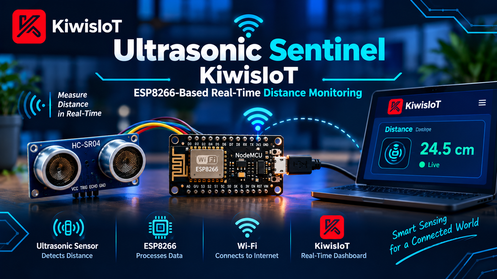
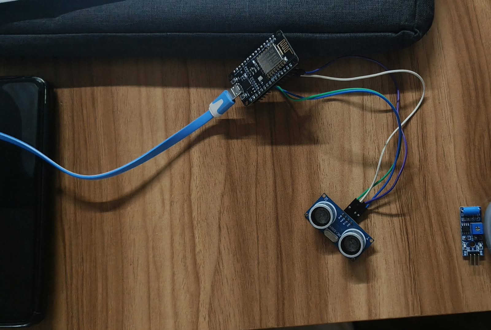
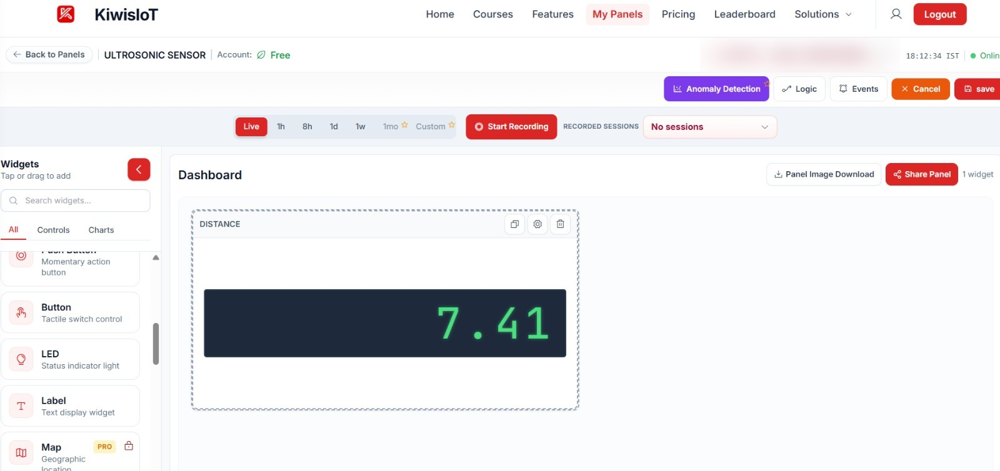

# 📡 Ultrasonic Sentinel KiwisIoT: ESP8266-Based Real-Time Distance Monitoring


**Ultrasonic Sentinel KiwisIoT** is an IoT-based distance monitoring system built with an **ESP8266 NodeMCU** and an **ultrasonic distance sensor (HC-SR04)**. The sensor measures the distance to an object, the ESP8266 calculates it in centimetres, and the value is sent over Wi-Fi to a **KiwisIoT** dashboard in real time.

> **Project ID:** KIWISIOT-003

<p align="center">
  
</p>

> The banner above is an illustrative graphic. See the dashboard and live test sections for real results.

---

## 📑 Table of Contents

- [Project Overview](#-project-overview)
- [How It Works](#-how-it-works)
- [System Architecture](#-system-architecture)
- [Components Required](#-components-required)
- [Software Requirements](#-software-requirements)
- [Circuit Connection](#-circuit-connection)
- [Distance Calculation](#-distance-calculation)
- [KiwisIoT Dashboard](#-kiwisiot-dashboard)
- [Arduino Code](#-arduino-code)
- [Getting Started](#-getting-started)
- [Testing the Project](#-testing-the-project)
- [Applications](#-applications)
- [Security](#-security)
- [Repository Structure](#-repository-structure)
- [Future Improvements](#-future-improvements)

---

## 📖 Project Overview

The ESP8266 triggers the ultrasonic sensor, measures the time taken for the echo to return, converts it to distance, and uploads the result to KiwisIoT every 2 seconds. If no echo is received, the reading is skipped and a message is printed to the Serial Monitor.

---

## ⚙️ How It Works

1. The ESP8266 sends a 10 µs pulse to the sensor's **TRIG** pin.
2. The sensor emits ultrasonic sound waves and waits for the reflection.
3. The **ECHO** pin stays HIGH for the time the sound takes to travel to the object and back.
4. The ESP8266 measures this duration with `pulseIn()` and calculates the distance.
5. The distance is sent to KiwisIoT **Channel 0** and shown on the dashboard.

---

## 🏗️ System Architecture

```
Ultrasonic Sensor  →  ESP8266 NodeMCU  →  Wi-Fi  →  KiwisIoT Dashboard
```

---

## 🧰 Components Required

| Component | Quantity |
|-----------|----------|
| ESP8266 NodeMCU | 1 |
| HC-SR04 Ultrasonic Sensor | 1 |
| Jumper Wires | 4 |
| USB Cable | 1 |

## 💻 Software Requirements

- [Arduino IDE](https://www.arduino.cc/en/software)
- ESP8266 Arduino Core
- `ESP8266WiFi` library
- `KiwisIoT` library
- A KiwisIoT account and dashboard topic ID

---

## 🔌 Circuit Connection

<p align="center">
  
</p>

| HC-SR04 Pin | NodeMCU Pin | Description |
|-------------|-------------|-------------|
| `VCC` | `VIN (5V)` | Sensor power |
| `GND` | `G (GND)` | Ground |
| `TRIG` | `D1` | Trigger pulse output |
| `ECHO` | `D2` | Echo pulse input |

> ⚠️ **Note:** The HC-SR04 echo pin outputs a 5V signal, while ESP8266 GPIO pins are 3.3V. For long-term or safer use, add a simple voltage divider on the `ECHO` line (for example 1 kΩ + 2 kΩ) before connecting it to `D2`.

---

## 📐 Distance Calculation

Sound travels at about **0.0343 cm/µs**. The echo time covers the trip to the object and back, so it is halved:

```cpp
float distance = duration * 0.0343 / 2;   // distance in cm
```

`pulseIn()` uses a 30 ms timeout, so readings beyond the sensor's range return no echo and are skipped.

---

## 📊 KiwisIoT Dashboard

<p align="center">
  
</p>

| Channel | Data | Widget |
|---------|------|--------|
| `0` | Distance (cm) | Label / Text display |

**Steps:**

1. Log in to KiwisIoT and create a new panel (e.g., *ULTRASONIC SENSOR*).
2. Add a **Label** widget named *DISTANCE* and bind it to **Channel 0**.
3. Copy the panel's **Topic ID** into the Arduino code.
4. Save the panel and watch the live distance values.

---

## 👨‍💻 Arduino Code

The sketch is also available at [`Ultrasonic_Sentinel/Ultrasonic_Sentinel.ino`](Ultrasonic_Sentinel/Ultrasonic_Sentinel.ino).

```cpp
/*
 * Project: Ultrasonic Distance Sensor with ESP8266 and KiwisIoT
 * Project ID: KIWISIOT-003
 * Board: ESP8266 NodeMCU
 * Sensor: Ultrasonic Sensor
 */

#include <ESP8266WiFi.h>
#include <KiwisIoT.h>

const char* ssid = "YOUR_WIFI_NAME";
const char* pass = "YOUR_WIFI_PASSWORD";

const char* topic = "YOUR_DASHBOARD_TOPIC_ID";

#define TRIG_PIN D1
#define ECHO_PIN D2

KiwisIoT kiwisiot(ssid, pass, topic);

void sendDistance() {

  digitalWrite(TRIG_PIN, LOW);
  delayMicroseconds(2);

  digitalWrite(TRIG_PIN, HIGH);
  delayMicroseconds(10);
  digitalWrite(TRIG_PIN, LOW);

  long duration = pulseIn(ECHO_PIN, HIGH, 30000);

  if (duration == 0) {

    Serial.println();
    Serial.println("Ultrasonic: No echo received");

    return;
  }

  float distance = duration * 0.0343 / 2;

  Serial.println();
  Serial.println("---------- ULTRASONIC MONITORING ----------");

  Serial.print("Distance: ");
  Serial.print(distance, 2);
  Serial.println(" cm");

  String distanceData = String(distance, 2);

  kiwisiot.send("0", distanceData);

  Serial.print("Sent to KiwisIoT Channel 0: ");
  Serial.print(distanceData);
  Serial.println(" cm");
}

void setup() {

  Serial.begin(115200);
  Serial.println("   ULTRASONIC DISTANCE MONITOR   ");

  pinMode(TRIG_PIN, OUTPUT);
  pinMode(ECHO_PIN, INPUT);

  digitalWrite(TRIG_PIN, LOW);

  Serial.println("Ultrasonic sensor initialized");

  Serial.println("Connecting to KiwisIoT...");

  kiwisiot.begin();

  Serial.println("KiwisIoT initialized");
  Serial.println("Starting distance monitoring...");
}

void loop() {

  kiwisiot.run();

  static unsigned long lastSend = 0;

  if (millis() - lastSend >= 2000) {

    lastSend = millis();

    sendDistance();
  }

  delay(100);
}
```

---

## 🚀 Getting Started

1. **Clone the repository**
   ```bash
   git clone https://github.com/<your-username>/Ultrasonic-Sentinel-KiwisIoT.git
   cd Ultrasonic-Sentinel-KiwisIoT
   ```
2. Install the Arduino IDE, the ESP8266 board package and the KiwisIoT library.
3. Wire the sensor as shown in [Circuit Connection](#-circuit-connection).
4. Open `Ultrasonic_Sentinel/Ultrasonic_Sentinel.ino`.
5. Update `ssid`, `pass` and `topic` with your own details.
6. Select **NodeMCU 1.0 (ESP-12E Module)** and the correct port, then upload.
7. Open the Serial Monitor at **115200 baud** and check your KiwisIoT dashboard.

---

## ✅ Testing the Project

1. Power the NodeMCU through USB and confirm the Wi-Fi/KiwisIoT connection in the Serial Monitor.
2. Place an object in front of the sensor and move it closer and farther away.
3. Confirm the distance value changes on the KiwisIoT dashboard.

**Sample Serial Output**

```
---------- ULTRASONIC MONITORING ----------
Distance: 7.41 cm
Sent to KiwisIoT Channel 0: 7.41 cm
```

---

## 🧪 Applications

- Distance and proximity monitoring
- Water or storage tank level estimation
- Parking assistance prototypes
- Obstacle detection for robots
- Learning sensor interfacing and IoT data streaming

---

## 🔒 Security

- Never commit real Wi-Fi credentials or your KiwisIoT topic ID. Keep the placeholders in the repository.
- Keep secrets in a separate `secrets.h` file listed in `.gitignore`.
- Blur or crop the Topic ID in any dashboard screenshot before sharing it publicly.

---

## 📁 Repository Structure

```
Ultrasonic-Sentinel-KiwisIoT/
├── Ultrasonic_Sentinel/
│   └── Ultrasonic_Sentinel.ino
├── images/
│   ├── banner.png
│   ├── kiwisIoT_dashboard.jpeg
│   └── live_image.jpeg
└── README.md
```

---

## 🔮 Future Improvements

- Threshold alerts and notifications through KiwisIoT events
- Distance history charts and data logging
- Buzzer or LED warning for close objects
- Median filtering for smoother readings
- Tank-level percentage display

---

<p align="center">Made with ❤️ using ESP8266 and KiwisIoT</p>
